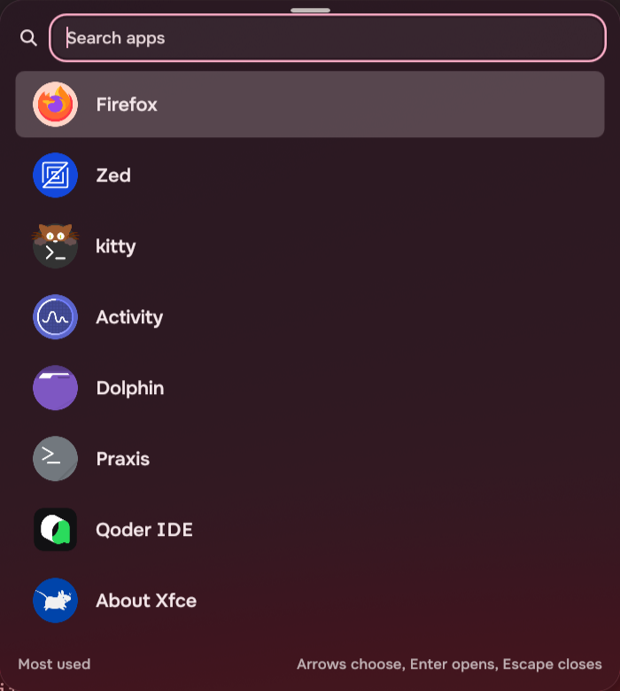
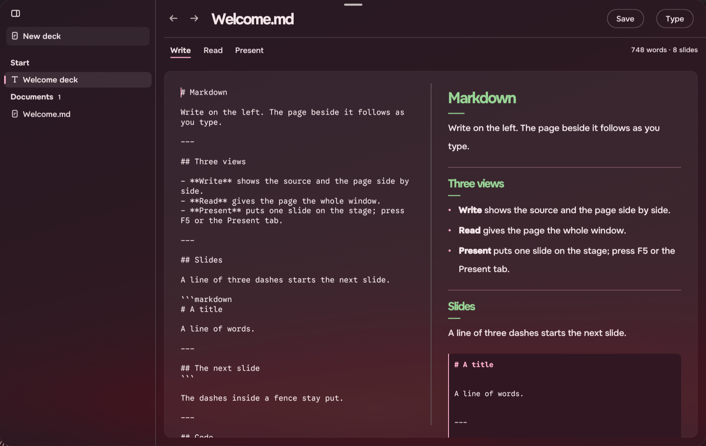
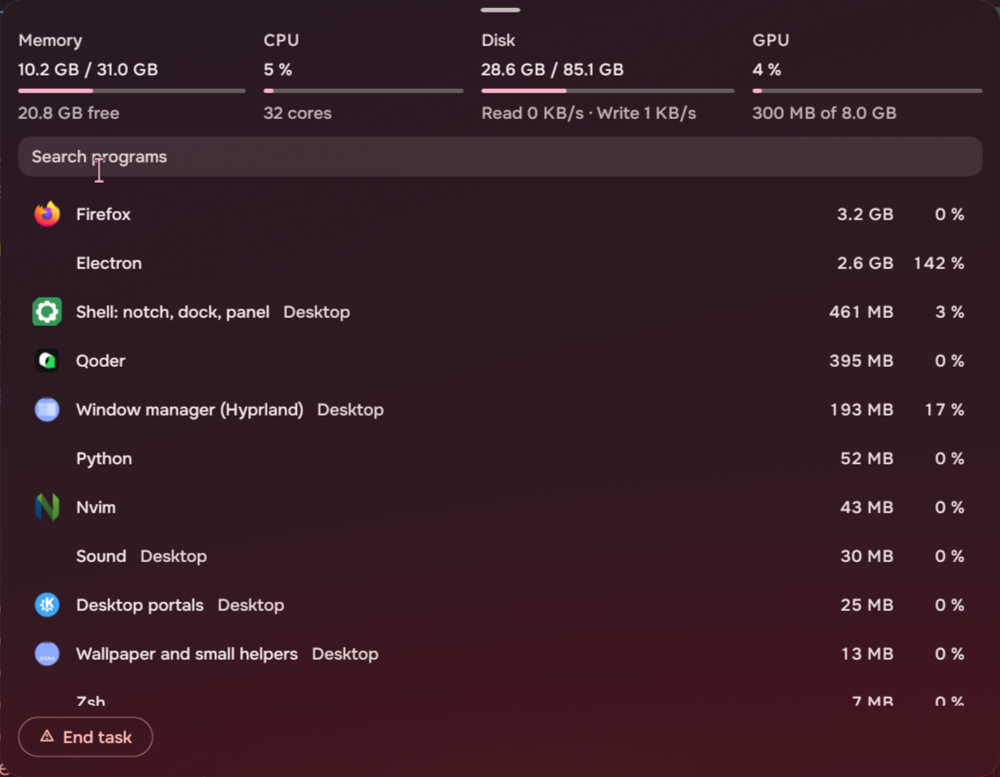
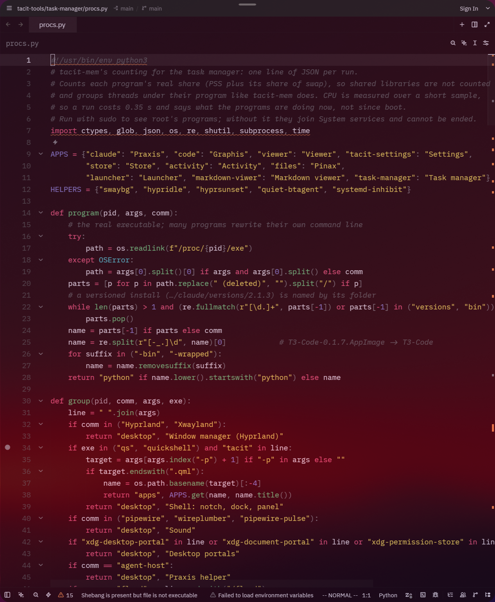

# tacit-tools

Small apps and ports built with [Quickshell](https://quickshell.org) 0.3+ and
[Tacit.Kit](https://design.tacitos.co) — the parts, rules and wallpaper-following palette of
Tacit's own apps. Everything here is dark, quiet, and takes its colours from the wallpaper.

## Install

```sh
git clone github.com/shahisandesh/tacit-application.git && cd tacit-application
./install.sh
```

The installer activates each piece, and re-running it is safe — it adds only what is missing:

- binds **Ctrl+Space** to the launcher and writes its window rules (Hyprland custom Lua config)
- writes window rules for the Markdown viewer and a **`tacit-markdown-viewer.desktop`** entry into
  `~/.local/share/applications`, so it appears in the launcher and app lists
- writes window rules for the task manager and a **`tacit-task-manager.desktop`** entry the same way
- generates the **Tacit Zed theme** if Zed is installed (`~/.config/zed/themes/tacit.json`)

Needs `qs` (Quickshell) on PATH; the launcher's copy-to-clipboard uses `wl-copy`.

## The apps

### launcher/



A keyboard-first app launcher: eight rows in one column, centred, opened with Ctrl+Space. With
nothing typed it shows the eight most-used apps (uses are counted in `~/.local/state/tacit-launcher/usage.json`,
so it learns habits as they go); typing narrows to the best eight matches by name, intent or
description. Two extra modes live in the same field:

- **Calculator** — type a sum (`2 + 2`, `10 * 4.5`, `2^10`) and the row shows the answer; Enter copies it.
- **Emoji** — type `:` and emoji appear by shortname (`:smile:`, `:correct:` ✅, `:congrats:` 🎉);
  typing narrows the list, Enter copies the emoji.

Enter or double-click opens, Escape closes, and it closes when focus truly moves away — a mouse
crossing the screen no longer dismisses it.

### markdown-viwer/



A Markdown reader, editor and presenter in one window: write (a plain source), read (rendered on
a dark glass sheet that takes the wallpaper's colour and glow) and present (the same Markdown as
a slide deck). Headings wear the palette's green, the accent marks rules, quotes, links and code
edges, and the Type panel lets the reader pick faces, size and line height. Run it directly with
`qs -p markdown-viwer/app.qml` or open it from the app list once installed.

### task-manager/



What the desktop is spending, in the same glass sheet. Four gauges across the head — memory,
CPU with its core count, disk space with live read and write speed, and GPU busy with its memory
(through NVML or sysfs; it says "No reading" when neither answers). The list is **programs, not
threads** —
`tacit-mem`'s counting (each program's real share: PSS plus its slice of swap, so shared libraries
are not counted twice), grouped by executable and sorted biggest first, with a CPU figure measured
over a short sample. It refreshes every two seconds and the cursor stays on the program it was on.
Typing narrows the list; Enter moves to the **End task** ring, which asks first — an ended program
does not come back, so there is no Undo, only the question. Root's programs join *System services*
and cannot be ended without sudo.

### zed-theme/



A port of Tacit's look to the [Zed](https://zed.dev) editor. `zed-theme/tacit_theme.py` reads the
same wallpaper palette the shell generates (`~/.local/state/quickshell/user/generated/colors.json`)
and reproduces Tacit.Kit's colour maths — the APCA-targeted inks, the washes, the accent — into a
Zed theme file: the editor sits on the same glass sheet as the viewer, text is quieter by ink and
never by opacity, and the accent marks focus, keywords and strings. Rerun `python3
zed-theme/tacit_theme.py` (or `./install.sh`) after a wallpaper change and the theme follows.

## Development

Each app runs with `qs -p <app>/app.qml` (on Tacit the kit is installed system-wide; elsewhere put
its `qml/` on `QML_IMPORT_PATH`). `AGENTS.md` at the root holds the rules every app here follows —
kit tokens only, no dialogs, no extra surfaces, one key for every pointer action. The launcher
takes a test query through the environment: `LAUNCHER_Q="2 + 2" qs -p launcher/app.qml`.
